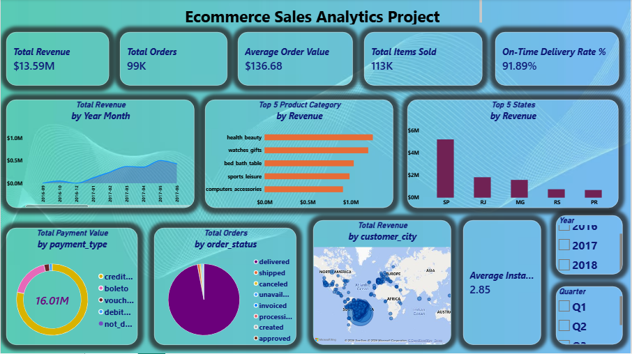

# Global E-Commerce Sales & Operations Performance Dashboard


An end-to-end Power BI business intelligence project transforming raw transactional data from Olist into a dynamic, single-page executive summary dashboard tracking financial health and fulfillment efficiency.

## 🧠 Business Problem & Objectives
A global marketplace required an executive-level performance interface to bridge the gap between sales revenue tracking and logistics bottlenecks. The primary objectives were:
* Consolidate disparate dimensional data into an optimized corporate model.
* Track core financial KPIs: Total Revenue, Average Order Value (AOV), and overall transaction metrics.
* Diagnose operations performance by monitoring geographic market concentrations and on-time shipment arrival rates.
* Analyze transactional payment methods and installment behaviors to understand consumer financing trends.

## 🏗️ Data Architecture & Star Schema Model
The project uses the Olist Relational E-Commerce Dataset structured into a clean **Star Schema** data model to optimize calculation speeds and prevent engine latency:
* **Fact Table:** `olist_order_items_dataset` (Central transaction table recording granular prices and item breakdowns).
* **Dimension Tables:** 
  * `olist_orders_dataset` (Main operational timeline and shipment logs).
  * `olist_products_dataset` (Product descriptions translated from Portuguese to English via Power Query).
  * `olist_customers_dataset` (Geographic location maps for buyers).
  * `olist_order_payments_dataset` (Transaction financing logs tracking methods and installment plans).
  * `Dim_Calendar` (Custom-built DAX master calendar table handling time-intelligence metrics).

### Schema Relationships
* `Dim_Calendar[Date]` -> `olist_orders_dataset[order_purchase_timestamp]` (1:*)
* `olist_customers_dataset[customer_id]` -> `olist_orders_dataset[customer_id]` (1:*)
* `olist_orders_dataset[order_id]` -> `olist_order_items_dataset[order_id]` (1:*)
* `olist_products_dataset[product_id]` -> `olist_order_items_dataset[product_id]` (1:*)
* `olist_orders_dataset[order_id]` -> `olist_order_payments_dataset[order_id]` (1:*)

## 🛠️ Data Engineering & ETL Challenges Overcome
* **Multi-Lingual Schema Mapping:** Handled raw localized data by importing dictionary translations inside Power Query, replacing Portuguese entries with English structures without breaking table indexes.
* **Timestamp Mismatch Resolution:** Fixed a critical axis grouping issue where exact timestamps (`YYYY-MM-DD HH:MM:SS`) caused trend charts to flatten. Successfully converted data keys into clean, standardized Date objects to establish continuous timeline increments.
* **Granular Layout Optimization:** Controlled report visual performance by stripping shipping weight columns and system identifiers, scaling category label width to provide integrated canvas scroll navigation.

## 🧮 Core DAX Measures Formulated
Below are the key explicit calculations written for this project:

```dax
Total Revenue = SUM('olist_order_items_dataset'[price])

Total Orders = DISTINCTCOUNT('olist_orders_dataset'[order_id])

Average Order Value = DIVIDE([Total Revenue], [Total Orders], 0)

Average Installments = AVERAGE('olist_order_payments_dataset'[payment_installments])

On-Time Delivery Rate % = 
VAR TotalDelivered = CALCULATE([Total Orders], 'olist_orders_dataset'[order_status] = "delivered")
VAR OnTimeOrders = 
    CALCULATE(
        [Total Orders],
        'olist_orders_dataset'[order_status] = "delivered",
        'olist_orders_dataset'[order_delivered_customer_date] <= 'olist_orders_dataset'[order_estimated_delivery_date]
    )
RETURN 
DIVIDE(OnTimeOrders, TotalDelivered, 0)
```

## 📈 Strategic Business Insights Discovered
1. **Dynamic Scaling Trends:** Evaluating performance using the `Year Month` timeline highlighted clear commercial growth trajectories alongside seasonal fulfillment demand spikes.
2. **Category Dominance:** Implementing top-category parameters identified key categories driving major capital volume, optimizing inventory management strategies.
3. **Logistics Bottlenecks:** Comparing revenue distribution against the 91.89% On-Time Delivery metric pinpointed key regional fulfillment zones needing distribution optimization.
4. **Payment Preferences:** Mapping order logs against payment distributions revealed heavy utilization of flexible financing installment structures across high-ticket sales.
